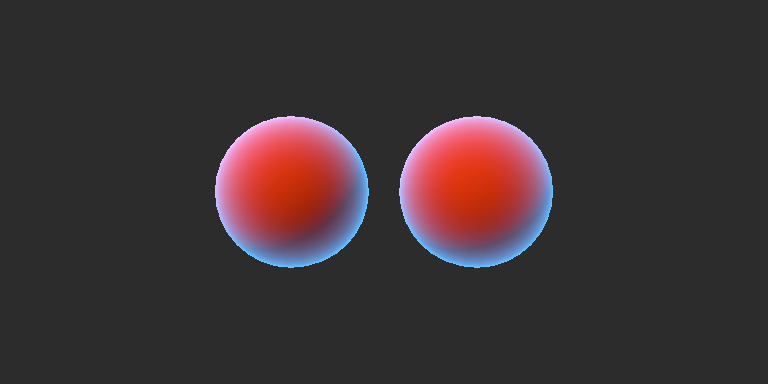

# ShaderFormalize

将两份手工改写的 HLSL 转成数学表达式，由 agent 编写证明，再让 Lean 检查它们在指定输入范围内的实数计算结果是否相同。当前支持入口/嵌套结构体、按值辅助函数、材质参数、局部变量和赋值，并在 Unity HDRP 中运行。

当前材质是纯色 Unlit，自行计算环境项、Lambert 方向光和平方边缘光。左球使用原始代码，右球使用代数改写后的代码：



主要输入是底色、光照颜色/方向、边缘光颜色/强度、环境亮度，以及插值法线和观察方向。材质参数可在 Unity Inspector 调整。原始写法分步计算，改写版复用结果并展开分配律；源文件见 [原始 HLSL](examples/unlit/original.hlsl) 和 [改写 HLSL](examples/unlit/optimized.hlsl)。

2026-10-24 完整验收通过：Lean 确认两份片元计算在约定实数域内等价；39 项回归、9 项证明控制及旧/新 Unity 检查通过。新材质 144 组 GPU/CPU 输入最大误差约 2.62×10⁻⁷；同一球体切换材质的对齐图像误差为 0，保存重载后的实际 HDRP 相机检查通过。[精简验收证据](planning/evidence/unlit-material-2026-10-24.json)

新增 [结构化原始 HLSL](examples/structured/original.hlsl) 与 [结构化改写 HLSL](examples/structured/optimized.hlsl) 使用相同效果，入口改为 PSInput.geometry，内部用嵌套结构体和多层辅助函数组织。原始通过 BuildSurface / EvaluateLighting / ShadeSurface 计算；改写使用不同内部类型及函数划分，复用结果并展开分配律。验证接受正常源码，不要求用户先拍平函数或结构体，也不自动生成改写版。

2026-10-25 完整验收通过：65项回归、12项正负控制及lerp/Unlit/structured三套Unity检查全部通过，结构化两份源码为PROVED，独立实现复核第二轮通过。结构化材质GPU/CPU最大误差2.6244×10⁻⁷，对齐图像误差0；隐藏两球后的场景隔离污染像素0。[本轮精简证据](planning/evidence/structured-material-2026-10-25.json)

## 在本机运行

环境为 Windows x64、PowerShell 7、Python 3.9+（标准库）、Git、curl。Unity 检查需要已打开并能由 unity CLI 连接的 Editor；当前验证工程使用 Unity 6000.5.9f1、HDRP 17.5.0、Direct3D12。Lean 与固定 DXC 安装在本仓库内，正式证明本身不依赖 Unity。

```powershell
# 首次配置本地工具及锁定依赖的编译缓存。
pwsh -File tools/bootstrap.ps1

# 完整验收：lerp、Unlit、结构化材质、证明负例与真实 HDRP 场景。
pwsh -File tools/run_demo.ps1 -UnityProject '你的 Unity 工程绝对路径'

# 只运行结构化材质的数学验证。
python tools/shaderformalize.py check --original examples/structured/original.hlsl --optimized examples/structured/optimized.hlsl --constraints examples/structured/constraints.json --agent-proof proof/StructuredProof.lean --output artifacts/structured/proof

# 只创建/检查 Unity 材质与演示场景。
python tools/run_unity.py --example structured --project '你的 Unity 工程绝对路径'
```

结构化材质的 Unity 资产生成在 Assets/ShaderFormalizeStructured/。打开其中的 **StructuredComparison.unity** 可以看到两个球；original.mat 和 optimized.mat 是可编辑材质。旧 --example unlit 继续生成 Assets/ShaderFormalizeUnlit/UnlitComparison.unity。保存的场景相机启用，并仅对自身关闭雾、曝光控制与后处理，避免既有工程效果覆盖材质；未改项目全局设置。运行器保存并重载场景，使用场景实际 Camera 的 HDRP RenderPipeline.StandardRequest 渲染回读，并另行对齐同一球体比较两份材质。

若目标场景已经打开，验证会另存 *.Validation.unity，报告同时给出 requestedScenePath 与实际 scenePath，保留已打开的场景。回读时为本次场景分配独立剔除掩码，避免已打开的旧球体进入图像；临时隐藏本次两球后，必须只剩背景（isolationPixels=0）。隔离设置只在重载后的验证期间使用，保存的场景仍可正常打开运行。

结构化材质预览输出为 artifacts/structured/unity/preview.png；GPU 报告与完整 CLI 日志在同目录。旧 Unlit 输出仍在 artifacts/unlit/unity/。数学报告位于对应 --output 目录，完整验收摘要在 artifacts/acceptance/result.json。持有写锁的运行先写 IN_PROGRESS，失败会更新报告；并发检查返回 INCONCLUSIVE，不覆盖当前运行者的报告。

## 数学验证具体保证什么

证明对象是 main 的片元材质计算：float 按实数解释，向量按相应数量的实数分量解释。两份程序采用同一顶点/插值/Unity 包装；本次没有形式证明顶点变换、光栅化、纹理过滤或整条 HDRP 管线。Unity 验证负责实际包装、编译、GPU 输出和已保存场景是否能工作，采用有限样本和浮点容差。

工具自动生成源码对应定义与待证明命题；证明由 agent 写在 proof/StructuredProof.lean 等文件，不自动搜索证明。检查器另建模块，导入本次生成定义和提交证明，将定理绑定到完整目标，并审计传递公理，只允许 propext、Classical.choice、Quot.sound。sorry、自定义公理和伪造同名目标不能得到 PROVED。

DXC、源码适配器和语义定义仍属于可信边界，尚未形式证明转换器本身。Lean 文件是本地可信开发输入，会由 Lean 执行，不作为陌生代码沙箱。

## 输入范围与归一化

材质使用 schema 2，完整约束见 examples/unlit/constraints.json：

```json
{
  "schema": 2,
  "ranges": {
    "_BaseColor": {"min": "0", "max": "1"},
    "_LightColor": {"min": "0", "max": "1"},
    "_RimColor": {"min": "0", "max": "1"},
    "_Ambient": {"min": "0", "max": "1"},
    "_RimStrength": {"min": "0", "max": "4"}
  },
  "nonzero_vectors": ["normalWS", "viewWS", "_LightDirection.xyz"]
}
```

向量范围表示每个分量都在同一闭区间；未列出的输入不加区间限制。端点是精确十进制字符串。normalize(v) 解释为 v / sqrt(dot(v,v))；零长度输入在 HLSL 中结果不定，因此每次实际执行的 normalize 都需要显式匹配的非零前提，形式上为 dot(v,v)>0。[Microsoft 规范](https://learn.microsoft.com/en-us/windows/win32/direct3dhlsl/dx-graphics-hlsl-normalize)

当前非零前提支持输入向量、分量选择及局部别名。缺少前提、名字/分量错误、矛盾区间或全零区间与非零条件冲突均拒绝。即使归一化结果随后被覆盖或未用于返回值，也检查其前提。对任意计算表达式归一化的输入域描述暂不支持，不自动添加更强假设。

结构化入口使用完整叶路径作为名称，例如 input.geometry.normalWS；范围和 nonzero_vectors 都可以使用该名称。完整叶名优先匹配，然后才解析末尾可选 swizzle，避免名为 xyz 的字段与分量选择混淆。函数实参即使被忽略或覆盖，也保留其求值和域检查；未调用函数不增加 normalize 前提。

## 目前的语言范围

- 一个返回 float4 的像素 main，输入可以是带 semantic 的值参数，或在叶字段带 semantic 的嵌套结构体；可有一个显式 register(b0) 的 cbuffer，字段为 float/float2/float3/float4。
- 普通具名嵌套结构体、字段读写、整结构体复制/返回、默认按值辅助函数及重载。DXC 决定字段/函数声明身份；导入器按已定类型的树建立数学值。参数帧与记录更新均按值隔离，辅助函数可读取 uniform。
- 局部声明、初始化、嵌套块、完整变量/字段赋值及 +=、-=、*=。每次赋值生成不可变的新绑定；helper 的按值参数可在其帧内修改，入口参数与 uniform 保持不可写。单字段读取只需该字段初始化；结构体复制/传参/返回必须全部叶字段初始化。
- 十进制数字、括号、加减乘、负号、向量构造、xyzw/rgba 分量、标量广播、dot、normalize、lerp、saturate。
- 参数顺序、名称、入口结构体名和完整字段布局/semantic、cbuffer 名/寄存器/字段顺序及输出 semantic 必须一致，不使用反射猜配。内部结构体/函数名可不同。

out/inout、函数原型/递归、结构体构造或聚合初始化、方法、向量分量左值、bool/分支/循环、矩阵/数组、原始除法、任意 pow、纹理/Buffer/裁剪/导数和预处理暂不支持。所有函数体静态检查节点、操作和调用身份；未知代码拒绝，不能通过藏在未调用 helper 中绕过。intrinsic 保留名不允许用户函数重定义。上限为64个结构体/每结构体64字段、16层结构体嵌套、每个结构体4096数值叶、128函数、32层调用、64输入叶、4096数值绑定，超限明确拒绝。结构体在展开前缓存计算深度和叶数，避免少量共享类型产生指数展开。

数字使用源码原始文字，拒绝八进制/十六进制/整数后缀；接受 LF/CRLF，拒绝预处理符号、反斜杠拼行和其他换行字符（包括注释中）。

| 状态 | 含义 |
|---|---|
| PREPARED | 已导入并生成命题，尚未检查证明 |
| PROVED | 本次目标和证明通过 Lean 检查与公理审计 |
| UNPROVED | 当前证明未通过；不能据此断言源码不等价 |
| UNSUPPORTED / INVALID_INPUT | 超出支持范围或输入/约束不合法 |
| ENVIRONMENT_ERROR / INCONCLUSIVE | 工具缺失/变化、超时或工作目录被占用 |

旧 examples/lerp/ 与 schema 1 标量区间仍保留：默认 python tools/shaderformalize.py check 验证 lerp(a,b,saturate(t)) 与 a+(b-a)*t，前提为 0≤t≤1。它继续参与统一验收。

## 源码、依赖和生成物

工具按职责划分：shader_ast.py 读取固定 DXC 的位置与精确数字，shader_types.py 解释声明身份/结构体类型和值，shader_validation.py 按语句/表达式/左值位置检查所有函数，shader_frontend.py 将函数局部执行转成不可变数值绑定，shader_lean.py 检查输入域并生成 Lean，shaderformalize.py 管理接口配对、快照、写锁和证明绑定。shader_eval.py 只提供有限数值回归对照，不生成数学证明。

proof/ShaderFormalize/Model.lean 定义实数语义。FetchCache.lean 复用锁定 mathlib 的原始哈希/下载/解压实现，仅获取当前所需模块。dependencies.lock.json 固定官方 Lean/DXC/leantar 归档与二进制 SHA256；proof/lake-manifest.json 固定 mathlib 和传递 Git revision。采用 Lean 自带依赖锁，不另叠加 submodule。工具与缓存都在本仓库，进程配置不改全局 PATH/elan/Git/curl 设置。

.tools/、.cache/、proof/.lake/、artifacts/ 与生成 Lean 模块均由 Git 忽略；提交源码、锁、手写证明、说明和精简验收证据。Unity Library 不复制进仓库，资产由模板和脚本重建。上轮下载归档/分片已清理约 1.36 GB；保留本地依赖和构建缓存，另有约 21 MB 中断 Git 临时包因审批策略拦截保留于忽略目录。
