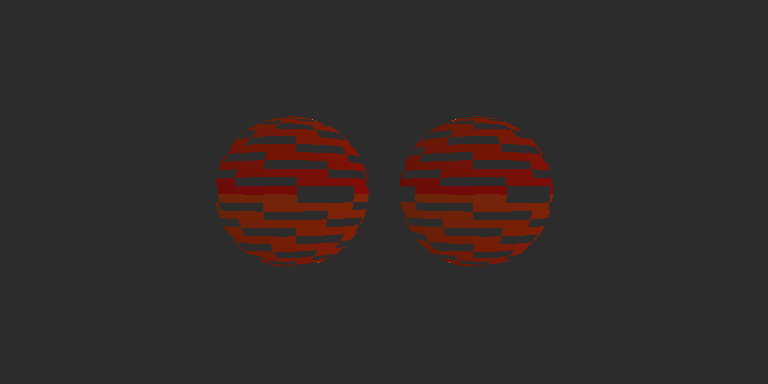

# ShaderFormalize

将两份 HLSL 经 DXC 已定类型的语法树转成理想实数与整数位字段模型，提供 agent 编写、迭代并独立检查 Lean 等价证明的本地环境。核心依赖固定版本 DXC、Lean 和 mathlib，安装、转换、证明和默认验收均不依赖 Unity。它不是任意 Shader 的自动等价判定器。

显式`--frontend shared`已支持实际共享helper定义、默认参数、out/inout及正常struct写法。[光照材质原版](examples/copyback/original.hlsl)通过out结构体和inout颜色累积，与[手工等价改写版](examples/copyback/optimized.hlsl)的完整数学目标已获证明；用法和边界见[共享函数说明](docs/shared-functions.md)。矩阵/数组及元素写回已接入，[新材质与具体契约](docs/aggregate-values.md)。[固定次数uint循环与组合材质](docs/static-loops.md)进一步组合采样、裁剪和导数；默认auto保留此前证明，完整HDRP/Lit Forward尚未完成。

[整数打包示例](examples/packed/original.hlsl)包含颜色量化、uint掩码/移位、float载体复制和拆包；[改写版](examples/packed/optimized.hlsl)直接使用量化结果。实数计算和位载体明确区分，完整范围及证明方式见[整数打包说明](docs/integer-packing.md)。

整数打包阶段的2026-10-26核心验收：128项回归及32项证明正负控制全部符合预期，12项完整目标PROVED；新增整数打包和定义域正负例均经过真实DXC、Lean绑定与公理审计。[阶段证据](planning/evidence/integer-packing-2026-10-26.json)。后续共享定义阶段146项单元/41项控制通过，[对应证据](planning/evidence/shared-functions-2026-10-26.json)。

矩阵/数组阶段完整验收：190项单元、53项正式控制全部符合预期（25 PROVED），独立Q2和同锁Windows三正例复现通过。[验收证据](planning/evidence/aggregate-2026-10-26.json)，[异地复现证据](planning/evidence/windows-aggregate-2026-10-26.json)。

最新默认参数/out/inout阶段：165项单元、47项正式正负控制全部符合预期（21 PROVED）；独立审阅和同锁Windows副本三例复现通过。[验收证据](planning/evidence/copyback-2026-10-26.json)，[独立副本证据](planning/evidence/windows-copyback-2026-10-26.json)。

最新 [原版分支材质](examples/branched/original.hlsl) 使用结构体、bool helper、提前返回、纹理开关、三种着色模式、嵌套条件裁剪和 ddx/ddy；[等价改写版](examples/branched/optimized.hlsl) 调整条件组织、使用三元选择并展开颜色计算。两边直接接受正常源码，不要求先拍平。原有 lerp、Unlit、structured、textured 示例和证明保留。

使用者从 [agent 证明工作流](docs/agent-workflow.md) 开始：生成完整命题，编写证明，运行检查器，根据诊断继续尝试。前一阶段的 [纹理材质机器证据](planning/evidence/textured-material-2026-10-25.json) 与 [历史执行记录](planning/fragment-effects/implementation-evidence.md) 保留供追溯。

2026-10-25完整默认核心验收通过：在PATH无法发现unity、未提供Unity工程的环境中，102项回归和27项证明正负控制均符合预期，10个完整目标PROVED。显式可选Unity五例均PASSED；新分支材质120组/245760像素与独立CPU公式的最大误差约2.38×10⁻⁸，裁剪mask一致，错误开关/阈值均有GPU反例。[机器证据](planning/evidence/control-flow-2026-10-25.json)，[本轮执行记录](planning/control-flow/implementation-evidence.md)。



## 本机运行

Windows x64、PowerShell 7、Python 3.9+标准库、Git、curl。本地 Lean4.24/DXC 及锁定 mathlib 安装到仓库内，不依赖 VS Code 的 elan 配置；固定下载地址、版本与哈希在依赖锁中。

另一台Windows机器从[异地启动指南](docs/windows-setup.md)开始，使用同名工作分支和本地bootstrap；Git不携带本机工具缓存或Unity工程。

```powershell
# 首次安装固定本地工具及当前所需编译缓存。
pwsh -File tools/bootstrap.ps1

# 默认完整核心验收：全部回归和证明正负控制，无需 Unity。
pwsh -File tools/run_demo.ps1

# 开发迭代时只检查分支示例及控制流回归。
pwsh -File tools/run_demo.ps1 -Example branched

# 只检查整数打包及其定义域正负控制，不调用Unity。
pwsh -File tools/run_demo.ps1 -Example packed

# 共享函数、默认参数及out/inout光照材质和定义域对照。
pwsh -File tools/run_demo.ps1 -Example copyback

# 矩阵、数组、元素写回及越界定义域的正式对照。
pwsh -File tools/run_demo.ps1 -Example aggregate

# 两次光照循环、矩阵/数组、采样、裁剪、导数的组合与域对照。
pwsh -File tools/run_demo.ps1 -Example complete

# 仅检查纹理材质数学等价。
python tools/shaderformalize.py check --original examples/textured/original.hlsl --optimized examples/textured/optimized.hlsl --constraints examples/textured/constraints.json --agent-proof proof/TexturedProof.lean --output artifacts/textured/proof

# 显式启用可选 Unity 开发验证：五套 GPU/已保存 HDRP 场景，不重复核心验收。
pwsh -File tools/run_unity_suite.ps1 -UnityProject '你的 Unity 工程绝对路径'
```

可选GPU检查需要已打开且unity CLI可连接的Editor；本机开发环境为Unity6000.5.9f1、HDRP17.5.0、Direct3D12。打开 `Assets/ShaderFormalizeBranched/BranchedComparison.unity` 查看分支材质；纹理例场景为 `Assets/ShaderFormalizeTextured/TexturedComparison.unity`。材质与受控纹理均持久化，可在Inspector调整参数。预览与报告位于 artifacts/<example>/unity/。脚本复制被证明HLSL的精确字节并校验哈希；数学报告位于指定 --output，完整核心摘要在 artifacts/acceptance/result.json。原 `run_demo.ps1 -UnityProject ...` 命令仍可在核心成功后追加可选GPU验证。

仍保留 --example lerp / unlit / structured：对应基础lerp、手写方向光/环境项/平方边缘光、正常结构化同效果。旧例及其证明继续参与完整验收；旧记录见[结构化材质证据](planning/evidence/structured-material-2026-10-25.json)。

Unity运行器保存并重新载入演示场景，再用其中实际Camera的HDRP StandardRequest回读，并在相同几何/相机上切换材质比较。相机只在自身关闭雾/曝光控制/后处理，未改项目全局设置。若目标场景已打开，另存 *.Validation.unity（必要时唯一化），保留用户场景。回读时分配本次场景独立剔除掩码，隐藏自有两球后必须只剩背景。验证临时状态在finally恢复，不保存到用户场景。

纹理例的数值pass使用64×32规则UV平面和16×16受控点采样纹理。UVCalibration校验包装层插值坐标，CPU独立计算texel、mip、梯度footprint、颜色和保留条件；每次绘制前清成负alpha背景，单独比较裁剪mask，包含clip零边界。测试并非只比较两份GPU结果。预览是实际保存场景的HDRP相机输出。

Unity包装目前仅指定shader target，未固定HLSL2021语言模式。GPU证据覆盖有限颜色和裁剪结果；当前材质不依赖未选分支中的非法运算。HLSL2021短路语义由固定 `-HV 2021` 的DXC和核心回归覆盖，未由Unity GPU测试验证。

## 证明保证

float解释为实数，向量为实数分量。普通数值程序保留schema2；旧纹理/简单裁剪用schema3；一般控制流用schema4。片元模型中varying为任意位置集合 E 上的完整函数，uniform为常量；输出为 E→Option Vec4，None表示丢弃，Some表示颜色。证明比较完整输出函数，包含裁剪结果；schema4目标另外要求所有实际执行的normalize有合法定义域。

schema5在相同执行模型中加入精确uint32及静态标记的float位载体，并要求已执行的实数转uint和移位合法。载体只保存位，不具有实数值；asuint(普通实数)和对载体做数值计算会拒绝。uint局部/内部struct/按值helper可用，整数stage输入、cbuffer和载体跨helper接口尚未开放。float底层编码/舍入不在模型中。[详细契约](docs/integer-packing.md)。

显式shared使用schema6，保留每个helper的实际计算定义与调用事件，输出同样包含完整颜色/丢弃字段及实际执行域。默认参数在声明作用域求值，out/inout用独立副本，在正常返回后写回；未定序的兄弟读写冲突和重叠输出拒绝。证明仍全称量化共享Ops，没有把helper结果作为未经证明的假设。

纹理/导数由定理全称量化的共享 `Fragment.Ops E` 提供。这是双方使用的同一组任意操作参数，不是新增公理：

- 采样保留纹理、Sampler、三种模式，以及完整UV、LOD或显式梯度函数；不假定过滤公式。
- 导数保留ddx/ddy及fine/coarse模式，作用于完整输入函数，向量逐分量；没有链式/乘积等微积分规则。
- schema3操作接收之前裁剪条件的有序序列；schema4统一接收一个完整执行条件函数，包含分支、此前裁剪和函数return。混合配对时旧前缀按合取提升为同一表示。输入函数与执行上下文相同，则同一共享操作结果相同。不模拟quad邻居/helper lane，也不默许把导数或隐式采样跨条件执行移动。
- clip(v)当且仅当每个分量≥0时保留，含0；discard无条件丢弃；if(p) discard保留¬p。裁剪条件引用执行当时的不可变快照，后续变量写入不改变它。

采样参数与裁剪边界依据官方定义：[Sample](https://learn.microsoft.com/en-us/windows/win32/direct3dhlsl/dx-graphics-hlsl-to-sample)、[SampleLevel](https://learn.microsoft.com/en-us/windows/win32/direct3dhlsl/dx-graphics-hlsl-to-samplelevel)、[SampleGrad](https://learn.microsoft.com/en-us/windows/win32/direct3dhlsl/dx-graphics-hlsl-to-samplegrad)、[clip](https://learn.microsoft.com/en-us/windows/win32/direct3dhlsl/dx-graphics-hlsl-clip)。共享操作模型只要求同一操作对同一完整输入给出相同输出。

因此Lean保证的是接受子集的理想实数/共享操作模型等价，不是GPU浮点逐位相同、过滤器实现或整条HDRP管线正确。两版采用相同顶点/插值/包装；顶点变换、光栅化和实际硬件行为由有限GPU测试覆盖，未形式证明。DXC、源码适配器和语义定义仍在可信边界内，转换器自身尚未形式证明。

工具生成定义及完整待证命题，proof/TexturedProof.lean等为手写证明。检查器另建模块绑定本次完整目标，并审计传递公理，仅允许propext、Classical.choice、Quot.sound。sorry、自定义公理、伪造同名目标均拒绝。报告保存源码、生成定义、证明、所用语义模块与依赖锁哈希。Lean证明是本地可信开发输入，不作为陌生代码沙箱。

## 输入范围

约束继续用schema2：ranges的键为输入完整名称，值为精确十进制字符串闭区间；向量逐分量、varying逐位置施加，未列输入不限区间。例如：

```json
{"schema":2,"ranges":{"_Tint":{"min":"0","max":"1"},"_Cutoff":{"min":"0","max":"1"}},"nonzero_vectors":[]}
```

结构体叶用 input.geometry.normalWS 等完整路径。normalize解释为 v/sqrt(dot(v,v))。schema2/3独立配对仍要求每个normalize有匹配的 nonzero_vectors 输入/swizzle前提，表示dot(v,v)>0，缺失返回INVALID_INPUT。schema4配对则生成每个运算的“执行条件→dot(arg,arg)>0”作为待证结论，可处理计算表达式及分支保证；显式nonzero_vectors仍只是用户提供的前提，工具不会偷偷添加假设。无法证明定义域返回UNPROVED。所有执行绑定和实参都检查，即使结果未使用；未调用函数检查语法、初始化和展开上限，不增加数学域义务。[HLSL normalize定义](https://learn.microsoft.com/en-us/windows/win32/direct3dhlsl/dx-graphics-hlsl-normalize)

## 支持的源码

以下基础列表说明默认auto。显式shared另支持尾部默认参数、out/inout、数值函数调用纯void计算helper、float矩阵/定长数组及字段/下标/不重复swizzle写回。具体边界见[共享函数](docs/shared-functions.md)和[复合值](docs/aggregate-values.md)。

- 一个返回float4、SV_Target的像素main；numeric值参数或叶字段带semantic的嵌套结构体输入；可选一个register(b0) cbuffer，float/float2/float3/float4字段。
- 具名嵌套结构体、字段读写、整记录按值复制/返回；默认按值非递归辅助函数及重载、读取uniform。入口参数/uniform不可写，helper参数可修改自己的副本。单字段读取只需该字段初始化；整记录复制/实参/返回须全部初始化。
- 局部声明/初始化/嵌套块、完整变量或字段的=、+=、-=、*=；精确十进制、括号、加减乘、负号、向量构造、swizzle、标量广播、dot/normalize/lerp/saturate。
- 标量bool局部、内部结构体字段及helper参数/返回；比较、!、&&、||、bool相等；一般if/else、嵌套分支、数值/记录/布尔赋值合并、标量条件?:、main与helper提前return。固定 `-HV 2021`，标量&&/||/?:短路；未进入的normalize不要求合法，已执行的必须证明合法。函数return仅结束当前调用，discard结束对应位置的整个Shader。普通别名/算术保留完整输入函数，guard外不会一律清零。
- 全局Texture2D<float4>（含默认Texture2D）和SamplerState，显式register(tN)/register(sN)，无重复槽位/别名。Sample(sampler,float2)、SampleLevel(sampler,float2,float)、SampleGrad(sampler,float2,float2,float2)。不接受offset/status/clamp等附加重载。
- ddx/ddy及各自fine/coarse的float1..4；clip(float1..4)、discard、if(两个float标量的< <= > >= == !=比较) discard，可有只含discard的花括号，无else。
- void辅助函数可包含上述裁剪/void调用，可无return或末尾return;。裁剪只能位于main/void helper语句；numeric/record helper不可改变裁剪状态，避免表达式求值顺序产生效果歧义。void调用只能是语句。

两份入口参数名/顺序/类型/完整名义布局/semantic、cbuffer字段布局及资源名/类型/顺序/槽位、输出semantic均须完全一致，错误直接拒绝，不靠反射猜配。内部结构体/函数名可不同。

两种后端均不支持bool stage输入/bool cbuffer、向量条件、循环、原型/递归、任意struct花括号初始化/方法、资源参数/别名、原始除法、任意pow、其它纹理/Buffer/compute操作以及预处理。auto额外拒绝默认参数/out/inout、向量分量左值和矩阵/数组；shared支持受控零转换。所有函数体检查具体语句/表达式/调用和初始化，不能把未知代码藏在未调用helper中。未知类型/节点/重载明确拒绝。[HLSL2021短路定义](https://github.com/microsoft/DirectXShaderCompiler/wiki/HLSL-2021)

上限：64结构体/每结构64字段、16嵌套层、每记录4096叶、128函数、32调用层、4096次展开调用、64输入叶、4096绑定、128裁剪事件、每种资源16个；控制流另限32层分支/每帧128返回分支，布尔共享图限4096节点/256深度。SSA与裁剪事件交错记录，完整条件以共享布尔图发射，避免重复展开。采样/导数结果可直接取分量，如 _BaseMap.Sample(...).rgb。数字使用原始源码文字，实数接受精确十进制；uint另接受十六进制及u后缀，拒绝八进制和超32位常量。接受LF/CRLF，不接受预处理/拼行及其它物理换行字符（含注释）。

| 状态 | 含义 |
|---|---|
| PREPARED | 已导入并生成命题，尚未检查证明 |
| PROVED | 本次完整目标及证明通过Lean与公理审计 |
| UNPROVED | 当前证明未通过，不能据此断言两份源码不等价 |
| UNSUPPORTED / INVALID_INPUT | 超出支持范围或输入/约束错误 |
| ENVIRONMENT_ERROR / INCONCLUSIVE | 工具缺失/变化、超时或目录占用 |

运行使用Windows文件锁；持锁者写IN_PROGRESS及最终报告；并发检查返回INCONCLUSIVE，不覆盖运行者报告。旧schema1/默认lerp命令保留。

## 文件与依赖

shader_ast.py读取固定DXC树和精确数字；shader_types.py解释声明/记录；shader_effects.py统一资源/方法/裁剪语法规则；shader_validation.py按位置静态检查全部函数；shader_frontend.py解释成SSA与效果事件；shader_lean.py检查域并生成旧数值模型，shader_fragment.py提升完整函数及效果；shaderformalize.py负责配对、快照、锁、目标绑定和审计。shader_eval.py与shader_fragment_eval.py只用于有限回归/具体反例，不生成形式证明。

shader_control.py拥有条件执行帧、Shader存活状态、分支合并及函数返回；shader_control_values.py提供不可变条件值；shader_boolean.py共享并化简命题图；shader_control_lean.py发射schema4及定义域结论。Control.lean复用既有数学定义，无新公理。shader_control_eval.py为独立有限求值器。

函数帧分别记录调用入口和函数内部路径：return按内部路径选择完整返回字段，执行guard再合并调用入口和Shader存活状态。这样分支中的恒等helper仍保留完整导数输入；未实际执行的helper运算不产生定义域要求，void helper的return不结束调用者，discard效果仍作用于整个Shader的对应位置。

shader_packing.py复用控制流并拥有uint类型/AST规则和载体流检查，shader_packing_lean.py发射精确位操作及转换定义域；Packing.lean复用Lean内置BitVec，保留原有公理白名单。shader_packing_eval.py仅供有限回归，不参与形式证明。

proof/ShaderFormalize/Model.lean和Fragment.lean定义数学语义。dependencies.lock.json固定官方工具与二进制SHA256；proof/lake-manifest.json固定mathlib/传递Git revision，无额外submodule；FetchCache复用锁定mathlib的缓存实现。进程局部配置不修改全局PATH/elan/Git/curl。

.tools/、.cache/、proof/.lake/、artifacts/、生成Lean模块由Git忽略；提交源码/锁/手写证明/模板/必要说明与精简证据。Unity资产由脚本重建，不把Library复制入仓库。实验和完整日志留artifacts便于诊断，正式材料见planning/evidence；用户资料不清理。

## 可选官方 HDRP/Lit 调查

`python tools/inventory_hdrp.py --project '外部Unity工程绝对路径'` 仅供开发调查。当前固定HDRP17.5.0的Lit Forward宏配置，镜像并记录146份相关源码，固定配置的预处理和完整DXC typed AST解析均成功。独立的 `tools/analyze_shader.py --ast ... --entry Frag --output ...` 已能输出调用上界、默认实参/全局初始化和能力缺口；ANALYZED只表示结构分析成功。数学转换器仍拒绝该输入，尚无Lit等价证明，也不把Unity包写入核心依赖。[具体缺口与复现](docs/hdrp-investigation.md)。

共享调用后端：见[共享函数说明](docs/shared-functions.md)，使用`--frontend shared`保留实际helper定义并生成schema6；默认后端兼容现有证明。
