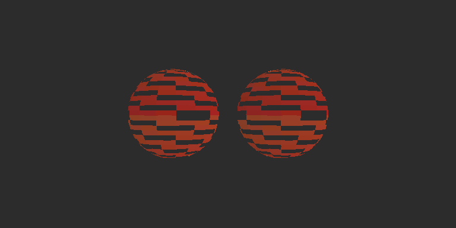

# ShaderFormalize

将两份 HLSL 经 DXC 已定类型的语法树转成理想实数模型，由手写 Lean 证明检查它们在指定输入范围内是否等价。当前能处理正常的结构体和辅助函数组织，以及 Texture2D 采样、裁剪和抽象导数；演示材质在 Unity HDRP 中实际运行。

最新 [原版纹理材质](examples/textured/original.hlsl) 使用 UV 变换、Surface 结构体、读取/裁剪/着色辅助函数；[等价改写版](examples/textured/optimized.hlsl) 改变函数划分并展开颜色计算。材质读取底图、指定 mip 与显式梯度采样，使用 ddx/ddy 计算纹理梯度和 footprint，通过 alpha 与高度裁剪。两边都直接接受正常源码，不要求先拍平，也不自动生成改写版。

2026-10-25 完整默认验收及独立实现复核第二轮通过：82项回归、18项证明控制及lerp/Unlit/structured/textured四套Unity检查全部成功。新材质Lean为`PROVED`，仅三个允许公理；24组参数/49152像素GPU与独立CPU公式最大误差约5.79×10⁻⁸，裁剪mask一致，23592个保留、25560个丢弃，8604个阈值恰好相等的片元保留。五种UV/导数/LOD/Sampler/裁剪错误均有实际GPU反例；保存重载HDRP相机对齐误差0、隔离污染0。57个实现/输入/模板/证明文件与最终快照哈希一致。[精简机器证据](planning/evidence/textured-material-2026-10-25.json)，[执行与复核记录](planning/fragment-effects/implementation-evidence.md)。



## 本机运行

Windows x64、PowerShell 7、Python 3.9+标准库、Git、curl。数学验证不依赖Unity；GPU检查需要已打开且unity CLI可连接的Editor。本机为Unity6000.5.9f1、HDRP17.5.0、Direct3D12。本地Lean4.24/DXC及锁定mathlib均在仓库内，不依赖VS Code的elan配置。

```powershell
# 首次安装固定本地工具及当前所需编译缓存。
pwsh -File tools/bootstrap.ps1

# 默认完整验收：全部回归、证明正负控制、四套Unity GPU/真实HDRP场景。
pwsh -File tools/run_demo.ps1 -UnityProject '你的 Unity 工程绝对路径'

# 仅检查纹理材质数学等价。
python tools/shaderformalize.py check --original examples/textured/original.hlsl --optimized examples/textured/optimized.hlsl --constraints examples/textured/constraints.json --agent-proof proof/TexturedProof.lean --output artifacts/textured/proof

# 仅生成材质/场景并执行真实GPU检查。
python tools/run_unity.py --example textured --project '你的 Unity 工程绝对路径'
```

打开 Unity 的 `Assets/ShaderFormalizeTextured/TexturedComparison.unity` 查看两颗带透明裁剪的球。original.mat / optimized.mat、含自定义mip的ControlledTexture.asset均持久化，可在Inspector调整参数。预览与报告位于 artifacts/textured/unity/。脚本复制被证明HLSL的精确字节，报告校验源哈希；数学报告位于指定 --output，完整摘要在 artifacts/acceptance/result.json。

仍保留 --example lerp / unlit / structured：对应基础lerp、手写方向光/环境项/平方边缘光、正常结构化同效果。旧例及其证明继续参与完整验收；旧记录见[结构化材质证据](planning/evidence/structured-material-2026-10-25.json)。

Unity运行器保存并重新载入演示场景，再用其中实际Camera的HDRP StandardRequest回读，并在相同几何/相机上切换材质比较。相机只在自身关闭雾/曝光控制/后处理，未改项目全局设置。若目标场景已打开，另存 *.Validation.unity（必要时唯一化），保留用户场景。回读时分配本次场景独立剔除掩码，隐藏自有两球后必须只剩背景。验证临时状态在finally恢复，不保存到用户场景。

纹理例的数值pass使用64×32规则UV平面和16×16受控点采样纹理。UVCalibration校验包装层插值坐标，CPU独立计算texel、mip、梯度footprint、颜色和保留条件；每次绘制前清成负alpha背景，单独比较裁剪mask，包含clip零边界。测试并非只比较两份GPU结果。预览是实际保存场景的HDRP相机输出。

## 证明保证

float解释为实数，向量为实数分量。普通数值程序保留schema2模型。涉及片元操作时使用schema3：varying输入为任意位置集合 E 上的完整函数，uniform仍为常量；输出为 E→Option Vec4，None表示丢弃，Some表示颜色。证明比较完整输出函数，包含裁剪结果。

纹理/导数由定理全称量化的共享 `Fragment.Ops E` 提供。这是双方使用的同一组任意操作参数，不是新增公理：

- 采样保留纹理、Sampler、三种模式，以及完整UV、LOD或显式梯度函数；不假定过滤公式。
- 导数保留ddx/ddy及fine/coarse模式，作用于完整输入函数，向量逐分量；没有链式/乘积等微积分规则。
- 操作同时接收执行前裁剪条件函数的有序序列。输入函数与上下文相同，则同一共享操作结果相同。此模型不模拟quad邻居/helper lane，也不默许把导数或隐式采样跨裁剪移动。
- clip(v)当且仅当每个分量≥0时保留，含0；discard无条件丢弃；if(p) discard保留¬p。裁剪条件引用执行当时的不可变快照，后续变量写入不改变它。

采样参数与裁剪边界依据官方定义：[Sample](https://learn.microsoft.com/en-us/windows/win32/direct3dhlsl/dx-graphics-hlsl-to-sample)、[SampleLevel](https://learn.microsoft.com/en-us/windows/win32/direct3dhlsl/dx-graphics-hlsl-to-samplelevel)、[SampleGrad](https://learn.microsoft.com/en-us/windows/win32/direct3dhlsl/dx-graphics-hlsl-to-samplegrad)、[clip](https://learn.microsoft.com/en-us/windows/win32/direct3dhlsl/dx-graphics-hlsl-clip)。共享操作模型只要求同一操作对同一完整输入给出相同输出。

因此Lean保证的是接受子集的理想实数/共享操作模型等价，不是GPU浮点逐位相同、过滤器实现或整条HDRP管线正确。两版采用相同顶点/插值/包装；顶点变换、光栅化和实际硬件行为由有限GPU测试覆盖，未形式证明。DXC、源码适配器和语义定义仍在可信边界内，转换器自身尚未形式证明。

工具生成定义及完整待证命题，proof/TexturedProof.lean等为手写证明。检查器另建模块绑定本次完整目标，并审计传递公理，仅允许propext、Classical.choice、Quot.sound。sorry、自定义公理、伪造同名目标均拒绝。报告保存源码、生成定义、证明、所用语义模块与依赖锁哈希。Lean证明是本地可信开发输入，不作为陌生代码沙箱。

## 输入范围

约束继续用schema2：ranges的键为输入完整名称，值为精确十进制字符串闭区间；向量逐分量、varying逐位置施加，未列输入不限区间。例如：

```json
{"schema":2,"ranges":{"_Tint":{"min":"0","max":"1"},"_Cutoff":{"min":"0","max":"1"}},"nonzero_vectors":[]}
```

结构体叶用 input.geometry.normalWS 等完整路径。normalize解释为 v/sqrt(dot(v,v))，每个实际执行的normalize必须有匹配的 nonzero_vectors 输入或swizzle前提，表示dot(v,v)>0；支持沿赋值/参数/字段/返回追踪别名。缺失/错误/矛盾前提拒绝，不替用户猜测。所有执行绑定和裁剪条件都检查，即使结果被覆盖、调用实参未被消费或结果未返回；未调用函数只检查语法，不增加域前提。暂不支持计算表达式归一化的域描述。[HLSL normalize定义](https://learn.microsoft.com/en-us/windows/win32/direct3dhlsl/dx-graphics-hlsl-normalize)

## 支持的源码

- 一个返回float4、SV_Target的像素main；numeric值参数或叶字段带semantic的嵌套结构体输入；可选一个register(b0) cbuffer，float/float2/float3/float4字段。
- 具名嵌套结构体、字段读写、整记录按值复制/返回；默认按值非递归辅助函数及重载、读取uniform。入口参数/uniform不可写，helper参数可修改自己的副本。单字段读取只需该字段初始化；整记录复制/实参/返回须全部初始化。
- 局部声明/初始化/嵌套块、完整变量或字段的=、+=、-=、*=；精确十进制、括号、加减乘、负号、向量构造、swizzle、标量广播、dot/normalize/lerp/saturate。
- 全局Texture2D<float4>（含默认Texture2D）和SamplerState，显式register(tN)/register(sN)，无重复槽位/别名。Sample(sampler,float2)、SampleLevel(sampler,float2,float)、SampleGrad(sampler,float2,float2,float2)。不接受offset/status/clamp等附加重载。
- ddx/ddy及各自fine/coarse的float1..4；clip(float1..4)、discard、if(两个float标量的< <= > >= == !=比较) discard，可有只含discard的花括号，无else。
- void辅助函数可包含上述裁剪/void调用，可无return或末尾return;。裁剪只能位于main/void helper语句；numeric/record helper不可改变裁剪状态，避免表达式求值顺序产生效果歧义。void调用只能是语句。

两份入口参数名/顺序/类型/完整名义布局/semantic、cbuffer字段布局及资源名/类型/顺序/槽位、输出semantic均须完全一致，错误直接拒绝，不靠反射猜配。内部结构体/函数名可不同。

仍不支持一般bool局部/输入或分支、循环、out/inout、原型/递归、结构体聚合初始化/方法、资源参数/别名、向量分量左值、矩阵/数组、原始除法、任意pow、其它纹理/Buffer/compute操作以及预处理。所有函数体静态检查具体语句/表达式/调用，不能把未知代码藏在未调用helper中。未知类型/节点/重载明确拒绝。

上限：64结构体/每结构64字段、16嵌套层、每记录4096数值叶、128函数、32调用层、64输入叶、4096数值绑定、128裁剪事件、每种资源16个。结构图在展开前缓存深度/叶数；SSA与裁剪事件交错记录，每个采样/导数先求参数，再立即留一个绑定，只引用已有上下文前缀；嵌套操作不会重复内联整棵程序。采样/导数结果可直接取分量，如 _BaseMap.Sample(...).rgb。数字使用原始源码文字，拒绝八/十六进制/整数后缀；接受LF/CRLF，不接受预处理/拼行及其它物理换行字符（含注释）。

| 状态 | 含义 |
|---|---|
| PREPARED | 已导入并生成命题，尚未检查证明 |
| PROVED | 本次完整目标及证明通过Lean与公理审计 |
| UNPROVED | 当前证明未通过，不能据此断言两份源码不等价 |
| UNSUPPORTED / INVALID_INPUT | 超出支持范围或输入/约束错误 |
| ENVIRONMENT_ERROR / INCONCLUSIVE | 工具缺失/变化、超时或目录占用 |

运行使用Windows文件锁；持锁者写IN_PROGRESS及最终报告；并发检查返回INCONCLUSIVE，不覆盖运行者报告。旧schema1/默认lerp命令保留。

## 文件与依赖

shader_ast.py读取固定DXC树和精确数字；shader_types.py解释声明/记录；shader_effects.py统一资源/方法/裁剪语法规则；shader_validation.py按位置静态检查全部函数；shader_frontend.py解释成SSA与效果事件；shader_lean.py检查域并生成旧数值模型，shader_fragment.py提升完整函数及效果；shaderformalize.py负责配对、快照、锁、目标绑定和审计。shader_eval.py与shader_fragment_eval.py只用于有限回归/具体反例，不生成形式证明。

proof/ShaderFormalize/Model.lean和Fragment.lean定义数学语义。dependencies.lock.json固定官方工具与二进制SHA256；proof/lake-manifest.json固定mathlib/传递Git revision，无额外submodule；FetchCache复用锁定mathlib的缓存实现。进程局部配置不修改全局PATH/elan/Git/curl。

.tools/、.cache/、proof/.lake/、artifacts/、生成Lean模块由Git忽略；提交源码/锁/手写证明/模板/必要说明与精简证据。Unity资产由脚本重建，不把Library复制入仓库。实验和完整日志留artifacts便于诊断，正式材料见planning/evidence；用户资料不清理。
