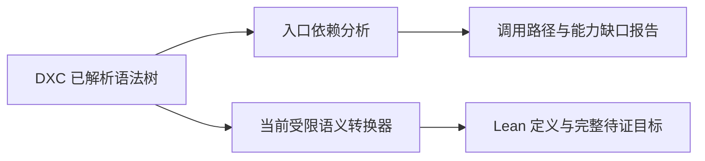

# 官方 HDRP/Lit 固定输入调查

这是下一阶段选材的开发记录，不属于核心运行依赖，也不是完整Lit验证结果。目前已取得确定配置的官方Shader，并完成入口依赖上界分析，让后续能力缺口有真实输入依据。

## 输入与复现

本机HDRP17.5.0，包缓存目录 `com.unity.render-pipelines.high-definition@6461a40020a9`，入口 `Runtime/Material/Lit/Lit.shader` 的共享HLSLINCLUDE和Forward Pass，片元函数Frag。工具只读取外部工程，将include镜像和报告写入ignored artifacts。

```powershell
python tools/inventory_hdrp.py --project '外部Unity工程绝对路径'
```

配置选择D3D11片元、DXC、target4.5、alpha test、关闭decal、FPTL灯列表、关闭屏幕空间阴影，固定三种阴影质量宏。DEFINES常量及result.json完整记录每个值；未选关键字保持未定义。Unity专用include_with_pragmas被转换为普通include，pragma原文保留为来源信息；这是一份明确的独立编译配置，未宣称复现Unity内部所有自动注入设置。

146份include已记录原始SHA256，预处理约620KB，DXC以ps_6_0、Frag、-HV2021成功生成约8.9MB typed AST。源与输出确切哈希由调查报告提供；包含关系同时扫到的非目标平台缺失include均在本配置下未生效。多份同名包缓存会明确拒绝，避免随机选版本。

## 入口分析的运行方法和保证

先显式从外部工程生成固定源码/DXC树，再运行独立分析：

```powershell
python tools/inventory_hdrp.py --project '外部Unity工程绝对路径' --output artifacts/hdrp-input
python tools/analyze_shader.py --ast artifacts/hdrp-input/typed-ast.log --entry Frag --inventory artifacts/hdrp-input/result.json --output artifacts/hdrp-analysis
```

分析命令本身只读明确提供的文件，不调用Unity、Lean或数学转换器；也可省略inventory分析任意DXC dump，此时只绑定AST字节，不验证Unity来源。提供inventory时，检查成功状态、AST哈希/字节数和预处理产物哈希；不依照manifest的绝对路径重新发现/读取Unity工程。



新增分析器按DXC声明ID追踪重载、资源方法和operator[]，保留原始/规范ID与签名；从Frag及保守的全局初始化根追踪，并恢复实际使用的默认实参。它不做常量传播或资源数据流分析，因此结果是可能调用集合的上界，不能把某条路径称为运行时必达。

退出0/ANALYZED表示调用结构闭合；退出2/INCOMPLETE表示仍有未知潜在调用、无法恢复默认参数等具体缺口；退出1/ERROR表示输入/来源/预算等错误。prev链若打印签名不一致，保守返回INCOMPLETE，不自写HLSL别名类型推断或跨签名恢复默认值。三者都不是PREPARED或PROVED。未知语义在分析器中可被列出，不意味着数学转换器已接受；核心对全部函数的静态拒绝规则没有改变。

## 当前固定Forward的实际结果

完整树有1388个函数定义，Frag及初始化依赖的上界包含284个定义。报告识别1039个调用点、108个不同的外部声明身份、13处默认实参、51处全局初始化根和140个全局引用。91259个AST节点包含NULL槽；统计按函数主体、默认实参与全局初始化分开，均是语法节点数，不是运行次数。

[本次精简机器证据](../planning/evidence/hdrp-forward-analysis-2026-10-26.json)保留固定宏、产物哈希、关键调用路径、默认实参及资源声明。完整图在显式指定输出目录的result.json，工具可从同一AST重新生成。

当前可达主体确有3个while、7个for、2个switch；涉及矩阵/数组、out/inout、整数位运算、除法/平方根等数学操作。30份被引用资源声明含6个只读StructuredBuffer，以及Texture2DArray、Texture3D、TextureCubeArray和比较采样器。实际外部调用含SampleBias、SampleCmpLevelZero、Load等既有子集之外的模式；未发现Wave/Interlocked调用或RW资源声明。这不保证其他Forward关键字配置也如此。

重要路径包括Frag→LightLoop（灯光/反射探针循环与Buffer读取），Frag→GetPreLightData（矩阵、预积分贴图），Frag→GetSurfaceAndBuiltinData→GetSurfaceData（材质字段/贴图）。默认值可能藏在callee参数声明中，全局初始化还存在 `unity_RendererUserValue = asuint(unity_RenderingLayer.y)`；仅扫函数CompoundStmt会漏掉这些依赖。工具对此有独立真实DXC回归。

固定不透明Forward自身定义SHADERPASS_FORWARD_BYPASS_ALPHA_TEST，源码注释说明alpha test由depth prepass执行；虽然此配置设了_ALPHATEST_ON，不能据此声称该Forward片元执行了裁剪。完整管线的depth prepass不是本片元入口分析的证明范围。

## 已确认的转换缺口

独立DXC已经完成语法、类型和重载解析。当前适配器尚不能消费这棵树，直接导入的首个错误是 `Unrecognized AST source header`：生成的sampler1D赋值方法含嵌套位置区间 `<col:8, <invalid sloc>>`，见typed-ast.log约6416行。这是适配器树读取格式的缺口，不能据此说DXC解析失败。

同一完整AST还确认了下列现有子集之外的声明或操作：

- 第一份Hash函数使用uint、异或与右移；它们需要整数/位运算语义，不能当作实数加减乘处理。
- Frag入口为void并用out float4参数输出，当前核心只接受返回float4的main；这需要入口/输出契约适配。
- sampler1D结构体含DXC隐式赋值方法，源码关联跨include文件；当前只支持单份普通源码及受控Texture2D/SamplerState声明。

入口上界分析已经排除一千余份无关定义，并为缺口给出调用路径；仍未做常量传播，不能把每个可达声明都称为该配置的运行时必需能力。此轮没有临时忽略未知节点或改写数学语义来“导入成功”。

位重解释需要单独划清数学边界。[asuint](https://learn.microsoft.com/en-us/windows/win32/direct3dhlsl/dx-graphics-hlsl-asuint)和[asfloat](https://learn.microsoft.com/en-us/windows/win32/direct3dhlsl/dx-graphics-hlsl-asfloat)读取位模式，不能直接当作实数数值转换。CopySign的位操作位于ignoreNegZero=false分支，其实际FastSign调用默认传true，可在后续常量分析中排除该分支；材质hash与rendering layer的float位载体则有实际数据用途。IsNaN还出现在反射探针错误数据恢复路径。当前没有为这些代码偷加浮点模型或忽略其效果；未来需明确位载体/合法输入域方案。

2026-10-26补充核查：通用uint打包与内部float载体已经接入，默认参数/out/inout共享函数也有正式材质证明；其当前契约见[整数打包](integer-packing.md)和[共享函数](shared-functions.md)。这仍没有解决普通实数的位编码。固定Forward中的一条可能路径为Frag→LightLoop→EvaluateBSDF_Env→EvaluateLight_EnvIntersection→IntersectSphereProxy→IsNaN；这是静态可能路径，未声称每次绘制执行。

本机Forward.preprocessed.hlsl的IsNaN约298行检查asuint(float)的指数/尾数位；IntersectRaySphereSimple约6600行先算判别式再sqrt，IntersectSphereProxy约15326行将NaN投影距离恢复为-1，再保证不小于最小投影距离。例如半径1、起点(2,0,0)、方向(0,1,0)，该公式的b=0、c=3、判别式=-12，已在纯实数sqrt定义域外。这条恢复逻辑说明，不能为了转换而一律将IsNaN换成false，也不能默添判别式非负前提。[DXIL的Sqrt说明](https://github.com/Microsoft/DirectXShaderCompiler/blob/main/docs/DXIL.rst#sqrt)给出负数返回NaN的行为；本项目尚未决定扩展这种非实数值语义。

独立手写最小复现保留于ignored artifacts/language-probes/real-nan-boundary.*：固定DXC解析成功，当前shared导入明确返回UNSUPPORTED，诊断为`asuint of an ordinary real requires unsupported float encoding`。它不是完整Forward的首个解析错误，也不是GPU验证；用途是单独暴露已约定实数模型的边界。恢复条件是证明该路径在明确配置/已提供输入域中不执行，或另行确定NaN/异常值恢复的数学契约；本轮不擅自引入IEEE模型、黑箱IsNaN或输入假设。

## 调查过程中的修正

初版导出没有SHADER_TARGET，Common.hlsl中FastLog2受 `SHADER_TARGET>=45` 保护而未定义。Lit自身声明target4.5，补充SHADER_TARGET=45后预处理和完整typed AST均成功。错误日志留在早期artifacts中供追溯；当前工具包含该宏，不能继续把FastLog2当现有阻塞。

共享函数/default/out/inout、矩阵/数组和uint打包已有普通材质证明，固定次数uint循环组合的正式控制也已通过，完整213单元/57控制及独立审阅已通过。完整Forward剩余接入包括Frag/out入口、只读资源和现有子集之外的循环/数学；还须先明确[实数边界的目标选择与恢复条件](../planning/hdrp-forward/real-boundary.md)。完整Forward不适合全部展开成4096条绑定；共享函数已缓解重复展开，但不能据此宣称动态灯光循环、资源读取和异常恢复已经处理。完整Lit尚未产生数学目标，已有普通材质证明不替代它。
